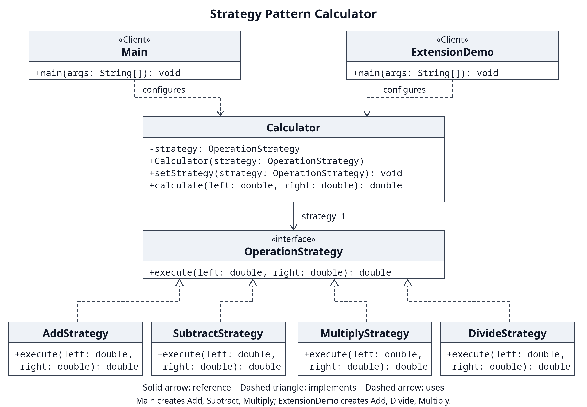

# Strategy Pattern Calculator Report

Course ShP-2216 Software Design Patterns, Astana IT University
Assignment 5, Option B Calculator
Repository: [Ziyadin23/assignment-5-strategy-pattern](https://github.com/Ziyadin23/assignment-5-strategy-pattern)

## 1 Introduction

This calculator implements a family of binary arithmetic algorithms: addition,
subtraction, and multiplication. Each algorithm implements `OperationStrategy`.
`Calculator` keeps the selected strategy and delegates calculations to it.
The client can replace that strategy while the same calculator object is running.

Strategy is a behavioral design pattern: an object changes its behavior by
receiving a different implementation of a common algorithm interface. Here,
the operands remain `12` and `4`, while changing the strategy produces `16`,
`8`, and `48`. A separate division extension demonstrates adding an algorithm
without changing the original application classes.

## 2 UML class diagram



The editable diagram is [uml.mmd](uml.mmd); [uml.svg](uml.svg) is a vector copy.

| Pattern role | Implementation | Responsibility |
| --- | --- | --- |
| Strategy | `OperationStrategy` | Declares `execute(double left, double right)` |
| Concrete strategies | `AddStrategy`, `SubtractStrategy`, `MultiplyStrategy` | Encapsulate one arithmetic algorithm each |
| Context | `Calculator` | Stores one strategy, replaces it, and delegates execution |
| Client | `Main` | Creates strategies, selects them, and handles console input |
| Extension | `DivideStrategy` and `ExtensionDemo` | Add division and wire it into the original context |

The solid arrow from `Calculator` to `OperationStrategy` represents its stored
reference. Dashed arrows with hollow triangles mean that concrete strategies
implement the interface. Dashed arrows from the clients mean they use the
context. There is no ownership diamond: the context accepts a supplied object,
and a stateless strategy could be shared.

## 3 Clean Code principles

### 1 Replace algorithm selection conditionals with polymorphism

A hypothetical earlier implementation would select arithmetic inside the context:

```java
// Before: illustrative code, not part of the application.
return switch (operation) {
    case "add" -> left + right;
    case "subtract" -> left - right;
    case "multiply" -> left * right;
    default -> throw new IllegalArgumentException();
};
```

The actual context executes the selected object:

```java
// Calculator.calculate: Java dispatches to the selected implementation.
return strategy.execute(left, right);
```

This removes the arithmetic decision tree from `Calculator`. The client's
command lookup and input validation still use control flow. Strategy removes
algorithm selection from the context; it does not eliminate all program branches.

### 2 Use meaningful names

```java
// SubtractStrategy.execute names both the operation and operand order.
public double execute(double left, double right) {
    return left - right;
}
```

`SubtractStrategy`, `left`, and `right` explain what happens without names such
as `Algorithm2` or `x`. Operand order matters for subtraction and division.

### 3 Give each class one responsibility

```java
// AddStrategy has no parsing, printing, or strategy selection.
public double execute(double left, double right) {
    return left + right;
}
```

An arithmetic change belongs to its strategy. A console interaction change
belongs to `Main`. `Calculator` manages delegation. Separating these reasons
to change keeps each class small and focused.

### 4 Depend on an abstraction

```java
// Calculator stores the contract, not AddStrategy or another concrete type.
private OperationStrategy strategy;

public Calculator(OperationStrategy strategy) {
    setStrategy(strategy);
}
```

The context knows only the common interface. A test supplies an unfamiliar
implementation and verifies that the context forwards both operands once.
This is dependency inversion and makes isolated testing straightforward.

### 5 Extend behavior without modifying stable classes

```java
// In the new ExtensionDemo client:
calculator.setStrategy(new DivideStrategy());
System.out.println("DivideStrategy: " + calculator.calculate(12, 4));
```

`DivideStrategy` implements the existing interface. The division extension
commit adds two production classes and changes no original Java class.
The context and the three original algorithms therefore stay closed to this
change while accepting the new behavior. Client wiring is still necessary;
this example places it in a new client. Adding a division command to the
original interactive menu would require changing that client's registry.

### 6 Keep methods small and cohesive

```java
// One method updates the strategy and checks its invariant.
public void setStrategy(OperationStrategy strategy) {
    this.strategy = Objects.requireNonNull(strategy, "Strategy must not be null");
}
```

The setter only replaces a valid reference; `calculate` only delegates.
`Main.runInteractive` manages the input loop, and `executeCommand` processes
one command. A null replacement fails before assignment, preserving the
previous strategy. These boundaries make behavior easy to read and test.

## 4 Verification and runtime demonstration

Run with JDK 17 and Bash:

```bash
./scripts/run.sh
./scripts/run.sh --interactive
./scripts/extension.sh
./scripts/test.sh
```

The default demo reuses one context and prints `16.0`, `8.0`, and `48.0`.
The extension reuses another single context and prints `16.0`, `3.0`, and
`48.0`. All 34 named tests pass: 27 cover the core and console, and seven
cover division. Tests check arithmetic, switching back to a previous strategy,
delegation, null handling, invalid input recovery, and both signed zero divisors.
They use explicit assertions and a failing process status without external libraries.

The project compiles with `--release 17 -Xlint:all -Werror`. Arithmetic uses
`double`, so decimal rounding and overflow follow Java behavior. The console
rejects non-finite input; division rejects zero. The example is single-threaded.

## 5 Advantages and disadvantages

| Advantages in this project | Costs and limitations |
| --- | --- |
| Algorithms can change independently | Each named algorithm adds a small class |
| One context changes behavior at runtime | Clients must know which strategy to select |
| New strategies reuse the original context | New client wiring or registration is still needed |
| Algorithms and delegation can be tested separately | More indirection can be excessive for three simple operations |

## 6 Conclusion

The calculator gains runtime flexibility through one interface and a replaceable
reference. Division shows that the original context does not need to grow with
the algorithm family. The cost is extra classes and client configuration. For
a tiny fixed calculator a conditional would be shorter; this design becomes
more useful as algorithms grow or change independently.

## References

- Assignment 5 Strategy Pattern Instructions, supplied course document, sections 2 through 5.
- [Refactoring Guru Strategy](https://refactoring.guru/design-patterns/strategy), pattern roles and tradeoffs.
- [Oracle Java 17 Objects](https://docs.oracle.com/en/java/javase/17/docs/api/java.base/java/util/Objects.html), `requireNonNull` contract.

Repository: [https://github.com/Ziyadin23/assignment-5-strategy-pattern](https://github.com/Ziyadin23/assignment-5-strategy-pattern)
